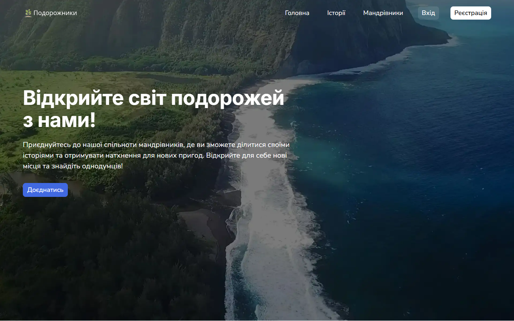
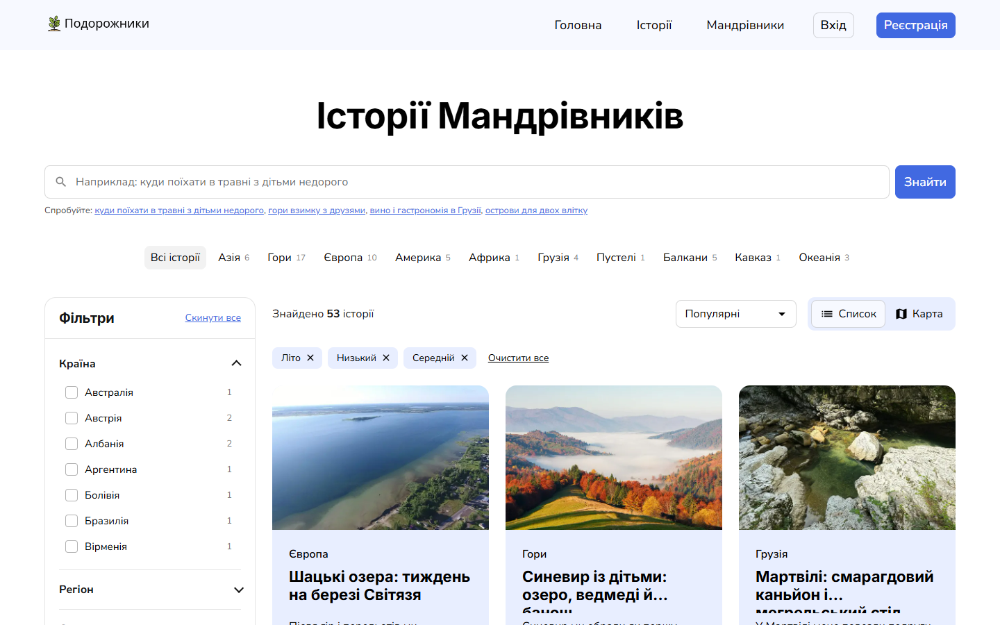
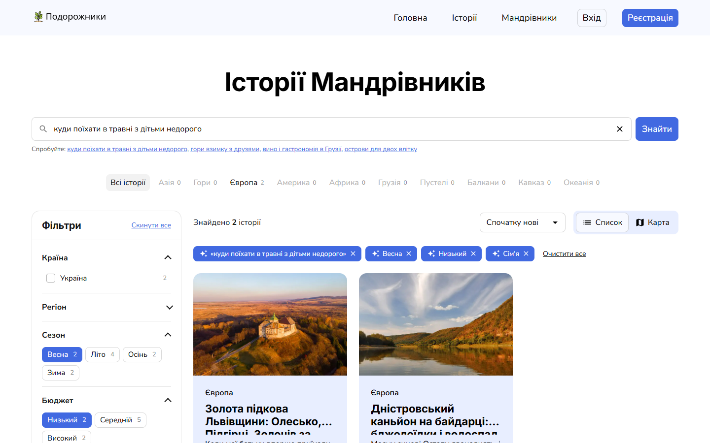
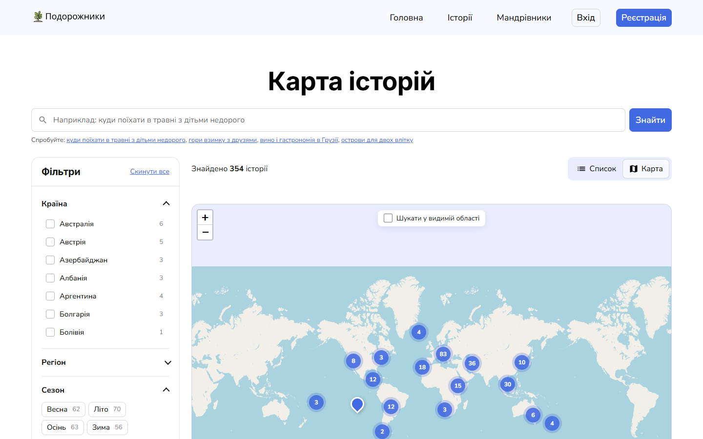
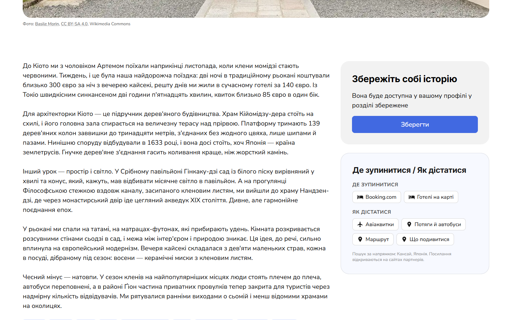
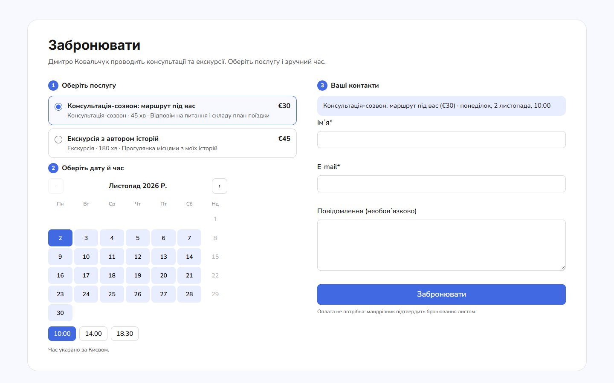
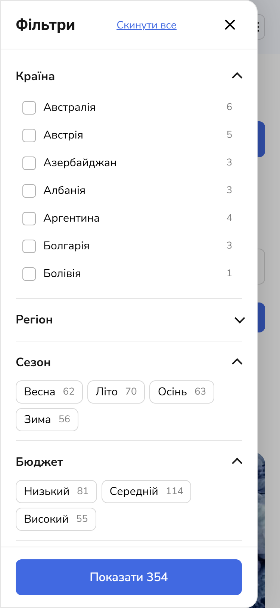
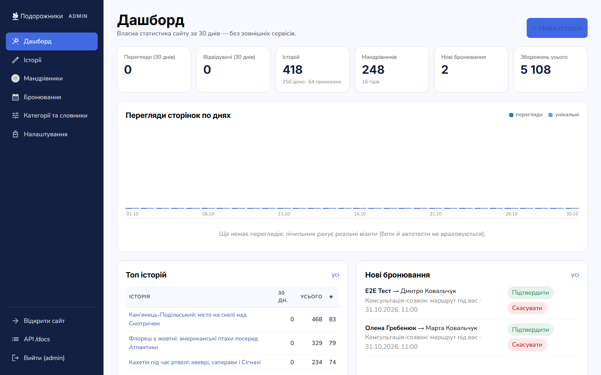
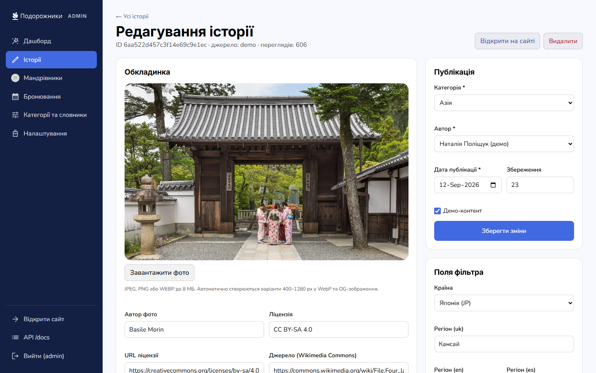
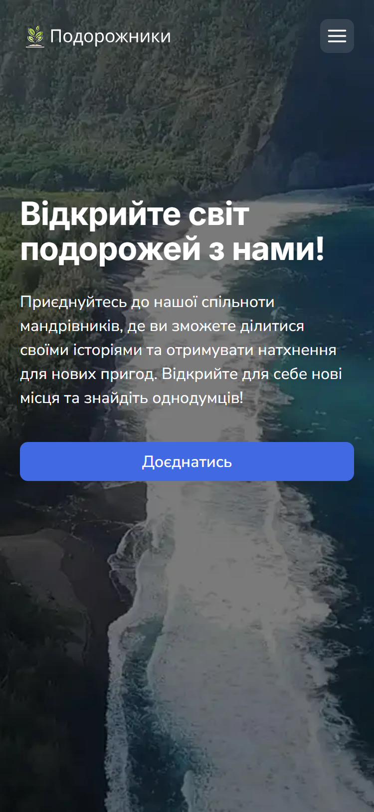

# Podorozhnyky+

> **One-command ready-to-run demo → [DEMO.md](DEMO.md)** (`scripts/demo.sh` / `scripts/demo.ps1`; the same data and images, nothing is generated).

A learning remake of the diploma project **Travel Stories / «Подорожники»** in Node.js.
From the outside it is the same site: the same design system, the same pages, the same spacing and fonts (checked pixel by pixel).
Inside it has server-side rendering, PostgreSQL and a set of features the original did not have:
a faceted filter, plain-language search, a map, guide bookings, three languages, an admin panel with analytics and an MCP server.

- Original: <https://travel-stories-frontend.vercel.app/> · API: <https://travel-stories-backend.onrender.com/docs/>
- Stack: Node.js 22, Express 5, Nunjucks (SSR), PostgreSQL 16, Knex, express-session + connect-pg-simple, sharp, zod (shared schemas for client and server), Leaflet, Vitest, Playwright, Docker.

The site's interface is Ukrainian (with `/en` and `/es` versions), so Ukrainian labels below are quoted as they appear on the site.



| Filter | Plain-language search | Map |
|---|---|---|
|  |  |  |
| **Story** | **Booking** | **Mobile filter** |
|  |  |  |
| **Admin: dashboard** | **Admin: editor** | **Phone** |
|  |  |  |

Check results (tests, visual diff, Lighthouse, load test) are in [docs/REPORT.md](docs/REPORT.md); the decisions taken are in [DECISIONS.md](DECISIONS.md).

## How it differs from the original

| | Original | Podorozhnyky+ |
|---|---|---|
| Rendering | Next.js, data is fetched in the browser | SSR with Nunjucks, JS only for interactivity, everything also works without JS |
| Storage | MongoDB | PostgreSQL 16 + Knex migrations |
| REST API | `/api/*`, 20 operations | the same 20 operations with the same envelope, messages, limits and errors + `/api/v2/*` |
| API docs | Swagger | Swagger UI at `/docs` (original contract + v2), `/docs/openapi.json` |
| Filter | category chips | category chips + facets: country, region, season, budget, duration, trip type, tags; a count on every option, empty options disabled, readable URLs, SSR, sorting |
| Search | — | plain language: «куди поїхати в травні з дітьми недорого» ("where to go in May with kids on a budget") → facet chips (LLM or built-in rules) |
| Map | — | `/map` and a "Map" view in the catalogue, clusters, card preview, «шукати у видимій області» ("search in the visible area") |
| Booking | — | a «Гіди» (Guides) menu section, `/guides` with filters, a «Гід» (Guide) badge, a booking block on profiles, a CTA on story pages, a confirmation page with a one-time cancel link |
| «Де зупинитися / Як дістатися» ("Where to stay / How to get there") | — | links to hotels, tickets and directions; partner IDs set in the admin |
| Saving stories | logged-in users only | anonymous: the list lives in localStorage, only the counter goes to the server (rate-limited) |
| Languages | uk | uk (no prefix), `/en`, `/es`: full interface; content in uk+en, es via «Перекласти» ("Translate") |
| SEO | title | title + description everywhere, OG, JSON-LD (Article, ProfilePage/Person, BreadcrumbList, WebSite), hreflang, sitemap.xml for all languages, robots.txt |
| Images | Cloudinary | sharp: WebP 400–1280 px, srcset/sizes, lazy, width/height, OG JPEG, placeholder |
| Content | ~160 stories, many of them test records | import of the original (test records and duplicates hidden by moderation) + 250 new stories and 80 travellers, Wikimedia Commons photos with licences |
| Admin | — | `/admin`: analytics dashboard, stories, travellers, dictionaries, bookings, settings, demo cleanup |
| MCP | — | `/mcp`: search and CRUD for stories/travellers/categories, bookings, statistics |
| Error pages | default Next.js 404 | custom 404 and 500 in the site design |

## Run it with 2 commands

```bash
cp .env.example .env
```

```bash
docker compose up -d
```

Before the second step, put the DB password, `SESSION_SECRET` and the admin password hash into `.env` (see below).
The first start runs the migrations, loads the dictionaries, imports the original (fresh from the live API when it is reachable, otherwise the snapshot in the repository), the demo content and demo bookings, and generates the image variants. It takes 2–4 minutes; it is ready when `docker compose ps` shows `healthy`.

Site: <http://localhost:8350> · admin: <http://localhost:8350/admin> · API: <http://localhost:8350/docs> · map: <http://localhost:8350/map>

Full reset to a clean state:

```bash
docker compose down -v && docker compose up -d
```

## `.env` variables

| Variable | Purpose |
|---|---|
| `APP_PORT` / `APP_BIND` | external site port (8350) and bind address (`0.0.0.0`; `127.0.0.1` on a VPS) |
| `PUBLIC_URL` | public address — for canonical, hreflang, sitemap, OG and absolute URLs in the API |
| `SESSION_SECRET` | secret for admin sessions and the visitor hash |
| `POSTGRES_DB` / `POSTGRES_USER` / `POSTGRES_PASSWORD` | database; `POSTGRES_HOST_PORT` is the port on `127.0.0.1` for tools and tests (5440) |
| `ADMIN_USER` / `ADMIN_PASS_HASH` | admin login; the bcrypt hash goes in single quotes |
| `MCP_TOKEN` | MCP server token |
| `LLM_PROVIDER` / `LLM_API_KEY` / `LLM_MODEL` / `LLM_BASE_URL` | LLM for search and translations (optional) |
| `SMTP_HOST` / `SMTP_PORT` / `SMTP_USER` / `SMTP_PASS` / `SMTP_FROM` / `BOOKING_NOTIFY_EMAIL` | booking e-mails (optional) |
| `IMPORT_ORIGINAL` | `1` — refresh the original snapshot from the live API on the first start |
| `COMPOSE_SUBNET` | docker network subnet, if the default one is taken |

## Admin login

The login is `ADMIN_USER` (`admin` by default). The password is set as a hash:

```bash
docker compose run --rm --no-deps app node tools/hash-password.js 'new-password'
```

Put the resulting `ADMIN_PASS_HASH='…'` line into `.env` and restart with `docker compose up -d`.
In the local installation built during development the password was generated automatically and written as a `# ADMIN_PASS=` comment in `.env` (the file is not in git).

The login is protected: bcrypt, an httpOnly session stored in PostgreSQL, a CSRF token on every form and write request, a rate limit of 10 attempts per 15 minutes.

## LLM, SMTP and partner IDs

Everything is configured either in `.env` or in admin → «Налаштування» (Settings); values from the admin take precedence.

- **LLM.** `LLM_PROVIDER=anthropic` + `LLM_API_KEY` (default model `claude-haiku-5-5`) or `LLM_PROVIDER=openai-compatible` + `LLM_BASE_URL` (OpenAI, OpenRouter, a local Ollama at `http://ollama:11434/v1`, etc.). It is used by plain-language search (strict JSON schema, the answer is validated with zod) and by the «Перекласти» (Translate) button (en/es). Without a key, search runs on the built-in rule parser and untranslated stories are shown in Ukrainian with a note.
- **SMTP.** The customer gets e-mails when a booking is received, confirmed and cancelled; the admin gets a notification at `BOOKING_NOTIFY_EMAIL`. Without SMTP the e-mails show up in `docker compose logs app`.
- **Partner IDs.** Booking.com `aid`, Skyscanner associate id, Tripadvisor partner id. Without them the «Де зупинитися / Як дістатися» block gives plain search links.

## Guide bookings

A guide is a traveller who has «Приймає бронювання» ("Accepts bookings") switched on in the admin and at least one active service. In the demo data 25 generated travellers are guides (imported travellers from the original are not). Each has 1–3 services out of «Онлайн-консультація 30/60 хв» (online consultation, 30/60 min), «Пішохідна екскурсія» (walking tour) and «Планування маршруту» (route planning), with a display price and free slots for the next 30 days. All of this is created by the seed on a clean start (`tools/load-seed.js → loadBookingDemo`).

Where it shows on the site:

- **The «Гіди» (Guides) menu item** comes after «Мандрівники» (Travellers) in the header, the burger menu and the footer, in every language.
- **`/guides`** — a grid of cards: avatar, name, country and region (from the guide's stories), the nearest free slot, a «від …» ("from …") price and a «Забронювати» (Book) button. Filters by country, service type and date (a free slot on that day), «Показати ще» (Show more). The page is server-rendered, works without JS and has meta and OG tags plus JSON-LD `ItemList`.
- **Home page** — a «Популярні гіди» (Popular guides) section between «Наші Мандрівники» (Our travellers) and the CTA: 4 cards and «Переглянути всіх» (View all).
- **The «Гід» badge** — on traveller cards and on the profile. On the profile the booking block comes before the list of stories, and on phones a «Забронювати» button is pinned to the bottom.
- **Story page** — if the author is a guide, the text is followed by a «Хочете так само? Забронюйте консультацію з автором» ("Want the same trip? Book a consultation with the author") block that links to their booking block.

How a booking goes:

1. The visitor picks a service, a day and a time (Kyiv time) and fills in name, e-mail and a message. The fields are checked with the same zod schema as on the server.
2. The booking is created with the status «нова» (new). Double-booking a slot is impossible: the slot row is locked in a transaction and a partial unique index allows only one live booking per slot.
3. The visitor lands on the confirmation page `/booking/<token>` with the details. It also has a cancel link with a separate one-time key: once used, the key is erased and the link stops working.
4. The customer gets an e-mail with both links, the admin a notification at `BOOKING_NOTIFY_EMAIL`. Without SMTP the e-mails are written to the container log.
5. In the admin («Бронювання», Bookings) a booking can be confirmed or cancelled, and the customer gets an e-mail. A guide's services and slot schedule are set up on their page in the admin.

API: `GET /api/v2/guides?country&service&date&offset&limit`, `GET /api/v2/travellers/:id/booking`, `POST /api/v2/travellers/:id/bookings`. The POST response contains `confirmUrl` and `cancelUrl`. MCP: `bookings_list`, `booking_set_status`.

## Demo content and how to delete it

All generated records are flagged `isDemo` (in the admin: the «Тільки демо» (Demo only) filter in stories and travellers).
To delete it all at once: admin → «Налаштування» (Settings) → «Видалити весь демо-контент» (Delete all demo content); you have to type `DELETE`.
The original import and anything created by hand are not touched; after the cleanup the demo is not re-created on restarts.

## Deploying to a VPS (docker compose + nginx + https)

1. Install Docker and the compose plugin, clone the repository and fill in `.env` (`PUBLIC_URL=https://your-domain`, `APP_PORT=8350`).
2. Add `APP_BIND=127.0.0.1` to `.env` so the site listens locally only, and run `docker compose up -d`. Only nginx faces the outside.
3. nginx:

```nginx
server {
    listen 80;
    server_name example.com;
    location /.well-known/acme-challenge/ { root /var/www/certbot; }
    location / { return 301 https://$host$request_uri; }
}
server {
    listen 443 ssl http2;
    server_name example.com;
    ssl_certificate     /etc/letsencrypt/live/example.com/fullchain.pem;
    ssl_certificate_key /etc/letsencrypt/live/example.com/privkey.pem;
    client_max_body_size 12m;
    location / {
        proxy_pass http://127.0.0.1:8350;
        proxy_set_header Host $host;
        proxy_set_header X-Forwarded-For $proxy_add_x_forwarded_for;
        proxy_set_header X-Forwarded-Proto $scheme;
    }
}
```

4. Certificate: `certbot certonly --webroot -w /var/www/certbot -d example.com`, then `systemctl reload nginx`; renewal is `certbot renew` on a timer.
5. Backup: `docker compose exec db pg_dump -U $POSTGRES_USER $POSTGRES_DB > backup.sql` plus the `uploads` volume.

The app trusts the first proxy (`trust proxy`), so the client IP for rate limits and `secure` cookies work correctly behind nginx.

## Tests and checks

```bash
docker compose --profile test run --rm test
```

Runs Vitest in a container (Linux): unit tests (schemas, filter URLs, the query parser, facets against a brute-force count, the booking race) and the API contract against the original. On the host:

| Command | What it does |
|---|---|
| `npm test` | Vitest (needs Postgres on 5440 and a running site, `APP_URL`) |
| `npx playwright test` | E2E: home page, filter with URL, search, map, booking, admin CRUD, languages, mobile |
| `node tools/visual-diff.js` | pixel comparison with the original at 375/768/1440 (pixelmatch, content masked) |
| `node tools/lighthouse.js` | Lighthouse mobile for the home page, `/stories` and a story page |
| `node tools/loadtest-seed.js` | 10,000 synthetic stories in a separate DB and a facet query benchmark |
| `node tools/crawl-original.js` | reconnaissance of the original: screenshots, tokens, assets (read-only) |
| `node tools/import-original.js` | snapshot of the original API (read-only) |

If Playwright's bundled Chromium has no network access, add `PW_CHANNEL=chrome`.
The results of the latest run are in `docs/REPORT.md`.

## Structure

```
start.js                 entry point: middleware, routes, 404/500
knexfile.js, migrations/ PostgreSQL schema
src/core/                the "engine": db, ids, i18n, views, images (sharp), security, stats, mailer, llm, settings, http
src/shared/              shared by server and browser: zod schemas, facet dictionaries, filter URLs, slug
src/project/content.js   story/traveller queries and serialization (including the original API format)
src/project/services/    facets (SQL counts), nlsearch, booking, guides, translate, affiliate
src/project/routes/      pages (SSR), api-v1 (original contract), api-v2, admin, admin-content, seo, docs
src/project/mcp/         MCP: protocol, index, tools/{stories,travellers,categories,bookings,stats}
src/project/openapi/     v1.json (original contract) + v2.js
src/client/              browser JS (esbuild): main, catalog, saved, booking, guides, map, admin
views/                   Nunjucks: layouts, partials, pages, admin
public/css/              tokens, base, components/*.css (one file per component, BEM), admin.css
public/fonts, public/vendor  fonts, modern-normalize and Leaflet committed locally (no CDN)
languages/               uk.json, en.json, es.json
seeds/                   original/ (snapshot of the original), data/ (demo texts), media/ (photos + credits.json)
demo/                    db/demo.dump + uploads/ for the one-command demo (see DEMO.md)
scripts/                 demo.sh / demo.ps1, demo-reset.sh / demo-reset.ps1
tools/                   bootstrap, load-seed, import-original, crawl-original, visual-diff, lighthouse, loadtest-seed, demo-snapshot…
tests/                   unit/, api/, e2e/
reference-engine/        reference engine (not in git)
```

## API

- **v1 (as in the original):** `GET /api/categories`, `GET /api/stories?page&perPage&category`, `GET /api/stories/popular`, `GET /api/stories/:id`, `GET /api/users?page&limit`, `GET /api/users/:id`, plus `auth/register|login|refresh|session|logout`, `users/me`, `PATCH /api/users`, `PATCH /api/users/avatar`, `POST|PATCH /api/stories`, `stories/own|saved`, `stories/favorite/add|remove/:id`. Envelope `{ status, message, data }`, ids are 24-hex, imported records keep their `_id`.
- **v2:** `GET /api/v2/stories` (facets + counts), `/api/v2/facets`, `/api/v2/search?q=`, `/api/v2/map`, `/api/v2/stories/by-ids`, `POST /api/v2/stories/:id/save`, `/api/v2/stories/:id/travel-links`, `GET /api/v2/guides`, `GET /api/v2/travellers/:id/booking`, `POST /api/v2/travellers/:id/bookings`.

Details are in Swagger UI at `/docs`.

## MCP

`POST /mcp`, JSON-RPC 2.0, header `Authorization: Bearer <MCP_TOKEN>`. For example, to connect it in Claude Code:

```bash
claude mcp add --transport http podorozhnyky http://localhost:8350/mcp --header "Authorization: Bearer <MCP_TOKEN>"
```

Tools: `stories_search` (plain language included), `story_get`, `story_create`, `story_update`, `story_delete`, `story_translate`, `travellers_search`, `traveller_get|create|update|delete`, `categories_list`, `category_create|update|delete`, `bookings_list`, `booking_set_status`, `stats_overview`.

## Credits

- **The design and the original idea** belong to the authors of the diploma project «Подорожники» / Travel Stories: <https://travel-stories-frontend.vercel.app/>, API <https://travel-stories-backend.onrender.com/docs/>. The layout was reproduced from their site for learning purposes; the assets (logo, sprite, hero, join) are theirs.
- **Imported stories and profiles** come from the original's public API, with their own `_id`.
- **Demo story photos** come from Wikimedia Commons, free licences only; the author and licence of every photo are stored in the DB and credited under the cover (`seeds/media/credits.json`). Demo traveller avatars come from <https://randomuser.me>.
- **The demo content** (80 travellers, 250 stories in Ukrainian and English) is generated and flagged `isDemo`. The people and stories are fictional, the places are real.
- Map © OpenStreetMap contributors.

Remake by Rostislav Sofronov (realmag777).
